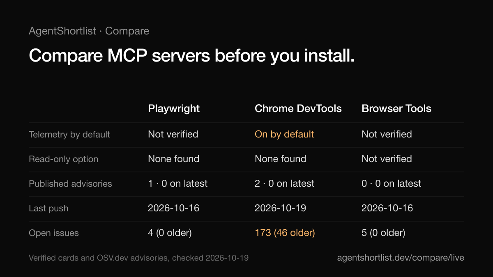

# AgentShortlist

**Evidence you can check before you install an MCP server.** For each server we write down what it can change, what it sends out, how it is maintained and how to limit it, with a source for every line.

Website: https://agentshortlist.dev · [Verified cards](https://agentshortlist.dev/verified) · [Config checker](https://agentshortlist.dev/check) · [Blog](https://agentshortlist.dev/blog)

[](LICENSE)
[](LICENSE-CONTENT.md)



## Why this exists

An MCP server runs on your machine or acts in your accounts with your token. Most directories tell you what is popular. They rarely tell you what a server can change, what it sends out, whether anyone answers its issues or whether it has published security advisories.

This project reads each project's own documentation and source and records the answer, with a link. Where something can't be checked, the card says **Not verified** instead of guessing.

## What is in it

| | |
|---|---|
| **[Verified cards](https://agentshortlist.dev/verified)** | 49 MCP servers. Each line shows its source (official docs, GitHub, package registry, OSV.dev, our own recommendation or "not verified"), a link and the review date. |
| **Security advisories** | Published advisories from [OSV.dev](https://osv.dev), matched to a package only after confirming that the package belongs to the same repository. Refreshed every day. |
| **[Config checker](https://agentshortlist.dev/check)** | Paste your MCP configuration. It flags documented safety options you haven't turned on, pinned versions that fall inside an advisory range and secrets written in plain text. It runs in your browser and sends nothing. |
| **[Picker](https://agentshortlist.dev/pick) and [live comparator](https://agentshortlist.dev/compare/live)** | Filter servers by what you need and compare two or three line by line. |
| **[Rankings](https://agentshortlist.dev/best/coding)** | 197 open-source AI projects (coding agents, MCP servers, frameworks, research and browser agents) scored on public GitHub signals. |

## What a card looks like

Every card has the same sections. This is a shortened example of the Grafana MCP server card (see the [full card](https://agentshortlist.dev/agents/grafana-mcp-server)):

| Section | Line | Source |
|---|---|---|
| Ways to expose fewer tools | `--enabled-tools`, a `--disable-<category>` flag per category and `--disable-write` to remove create and update tools | GitHub README |
| Can change data | Yes by default, through its create and update tools. `--disable-write` removes them. | GitHub README |
| Local files and shell commands | Not stated in the README. | Not verified |
| Latest release | v2.0.2, 2026-10-07 | GitHub |
| Open issues | 54, of which 32 were opened before 2026-07-20 | GitHub |

Each card also carries a hardening snippet taken from the project's own docs, when one exists.

## What we found

On 18 and 19 October 2026 we read 25 of these servers: only 5 documented a read-only mode, 3 sent telemetry by default and 40 advisories were published across 24 packages (none affected the latest npm and PyPI versions we checked). The tables and sources are in [We read 25 MCP servers](https://agentshortlist.dev/blog/we-read-25-mcp-servers). That is a dated snapshot, not a ranking or an audit.

## Principles

- **A source on every line.** If a line has no source, it is not published.
- **"Not verified" is an answer.** We never fill a gap by assumption.
- **Not a security audit.** A card says what the documentation and code said on the review date. Check the linked source before you rely on a line.
- **Rankings are a discovery aid.** They use three public signals (GitHub stars, recent activity and license) and a published formula, see the [methodology](https://agentshortlist.dev/methodology). Sponsored placements are labeled and never change a score.

## How it works

- Next.js 15 (App Router) with Tailwind 4, statically generated. No database of its own.
- GitHub data comes from the public API and is refreshed daily on the production server. Each refresh writes one dated snapshot, so [changes](https://agentshortlist.dev/changes) can be traced.
- Advisories come from OSV.dev through `scripts/osv-check.mjs`, which retries on network errors and refuses to overwrite the previous file if packages go missing.
- `npm run verify` runs 37 checks on the built site (data consistency, snapshots, links, structured data).

## Where things live

| Path | What |
|---|---|
| `src/content/verified.ts` | The verified cards, written by hand, with a source and URL per line |
| `src/content/verified-meta.ts` | Structured facts, config checks and settings used by the checker, picker and comparator |
| `src/content/advisories.json` | OSV.dev advisories |
| `src/content/blog/` | Blog posts in Markdown |
| `src/data/` | Ranking data and dated history snapshots (generated) |
| `src/app/` | Pages: `/verified`, `/check`, `/pick`, `/compare/live`, `/best/*`, `/blog`, ... |
| `scripts/` | Data refresh, snapshots, advisories, verification and SEO audit |

## Reuse the data

The cards and the data are open under CC BY 4.0. You can build on them, including commercially, if you credit AgentShortlist and link to https://agentshortlist.dev.

Suggested credit: `Data: AgentShortlist (https://agentshortlist.dev), CC BY 4.0`.

## Run it

```bash
npm install
npm run dev                        # http://localhost:3000
npm run build && npm run verify    # verify needs the site running on :3000
```

Optional environment variables: `GITHUB_TOKEN` for the data refresh, `RESEND_*` for the newsletter, `STRIPE_*` for sponsorship and `SYNC_TOKEN` for the sync route. None are needed to browse the site locally.

## Contributing

The most useful contribution is a correction with a source. Please open an issue with:

- The project name and its official repository
- For a correction: the line that is wrong and a link to the primary source
- For a new server: why people install it

Small pull requests are welcome too. See [CONTRIBUTING.md](CONTRIBUTING.md), or write to hi@agentshortlist.dev.

## License

- **Code**: MIT, see [LICENSE](LICENSE).
- **Content and data** (`src/content/`, `src/data/`, `docs/`): CC BY 4.0, see [LICENSE-CONTENT.md](LICENSE-CONTENT.md).
